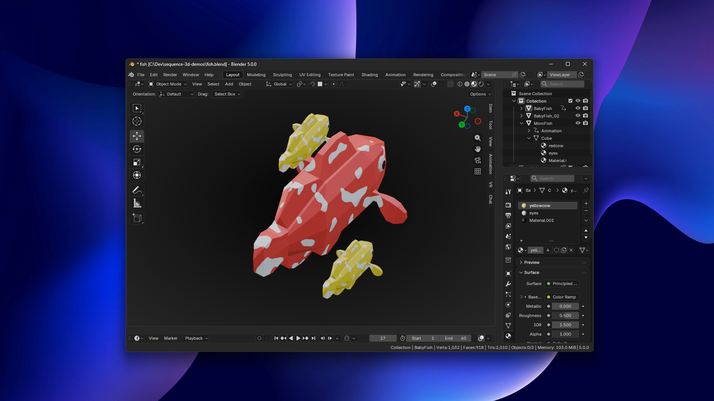
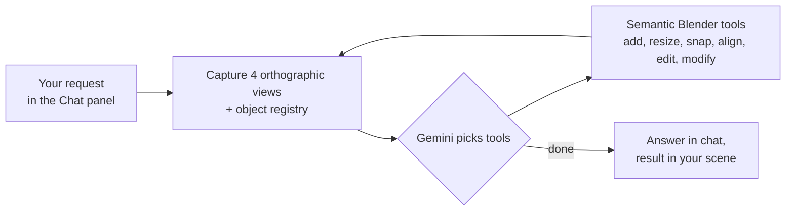

# Sequence 3D

**An AI agent inside Blender that builds and edits hard-surface 3D models from plain English, and checks its own work by looking at the scene.**

Designed and directed by [Tayyab Raza](https://www.linkedin.com/in/tayyab3245) · implemented with AI coding agents · Python, TypeScript

▶ **[Watch the demo on sequenceai.ca](https://sequenceai.ca/products/sequence-3d/#demo)**

---

## What it does

Sequence 3D is a Blender add-on with a chat panel. Type "put a cylinder on top of the cube, centred, half its width" and it does it, looks at the result, and fixes anything that's off. It can create and place objects, add modifiers and materials, edit meshes, set keyframes, and organize your scene. It can also build small custom control panels, like sliders for the number of teeth on a gear.

There are two modes. **Agent** mode changes your scene. **Ask** mode answers questions without touching anything. Every change goes through Blender's normal undo, so Ctrl+Z still works.

## How it works

The whole loop runs inside Blender. The add-on talks to Google Gemini directly with your own API key, so there is no account and no server in between. Each request can take up to 30 rounds of look, act, look again.

## Design decisions

- **The AI can see.** Every round, the model gets four fresh orthographic views of the scene plus an object registry: name, type, position, rotation, scale, real-world size, materials, and modifiers. It works from exact numbers rather than guessing from pixels, and it can spot its own mistakes in the images.
- **Semantic placement instead of coordinates.** The model never works out where a face is. It says "snap this onto the top face of that" or "align these centres," and a placement engine handles the geometry with ray casts, bounding boxes, and surface queries. Guessing raw coordinates was the biggest source of errors.
- **Size by dimensions, not scale.** Letting the model set scale directly made objects that looked right but reported the wrong size, and that broke every modifier after them. So objects are created at their real size, and a `resize` tool takes target dimensions in metres and does the maths itself.
- **Accurate clicking.** When the model points at something in a rendered view, a ray goes from that pixel into the scene and selects whatever it hits. If the target is too small in the view to hit reliably, the click is refused and the model is told to zoom in instead of guessing.
- **Escape hatches, with checks.** For anything the built-in tools can't do, the model can write Blender Python. That code is checked before it runs, and failures go back to the model so it can fix them.
- **You choose the model.** Gemini 3 Flash is the fast, cheap default. Gemini 3.1 Pro is slower but better at complex assemblies.

## How I tested it

- Gave it modeling tasks and checked: did it follow the prompt, is the orientation right, is the final result correct, did it crash?
- Tracked click accuracy until selection was reliable, and added the zoom-in rule for small targets.
- Kept a tool-by-tool capability tracker of what works, what's partial, and what fails.
- Judged it as a user: is it easy and helpful, does it save me time, can it organize my scene for me?

## Known limitations

- It can mix up left and right when the viewport is in an unusual orientation.
- Animation works but is plain (linear keyframes, no easing).
- Snapping can fail on messy or nearly flat geometry.

## Source

This is a showcase repository. The source code is private while the product is in development. **Source available on request.**
