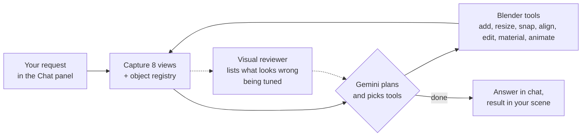

# Sequence 3D

**An AI agent inside Blender that works on your scene from plain English, looks at the result from eight angles, and checks its own work.**

Designed and directed by [Tayyab Raza](https://www.linkedin.com/in/tayyab3245) · implemented with AI coding agents · Python, TypeScript

▶ **[Watch the demo on sequenceai.ca](https://sequenceai.ca/products/sequence-3d/#demo)**

---

## What it does

Sequence 3D is a Blender add-on with a chat panel. Type "put a cylinder on top of the cube, centred, half its width" and it does it, looks at the result, and fixes anything that's off.

What it handles well today:

- **Placing and arranging objects:** snapping, aligning, stacking, and resizing to exact dimensions.
- **Materials and textures:** applying materials and generating procedural textures.
- **Animation:** keyframes, physics, and particles on existing objects.
- **Duplicating and organizing:** copies, arrays, scattering objects across a surface, renaming, and parenting.
- **Custom controls:** small panels with sliders, like the number of teeth on a gear.

Building complex models from scratch is still in progress (see [Where it's headed](#where-its-headed)).

There are two modes. **Agent** mode changes your scene. **Ask** mode answers questions without touching anything. Every change goes through Blender's normal undo, so Ctrl+Z still works.

## How it works

The whole loop runs inside Blender. The add-on talks to Google Gemini directly with your own API key, so there is no account and no server in between. Each request can take up to 30 rounds of look, act, look again.

## Design decisions

- **The AI sees from eight angles.** Every round, the add-on renders the scene from six straight-on views (front, back, left, right, top, bottom) plus two corner views from above. All eight use orthographic cameras, which have no perspective or lens distortion, so sizes and alignment read true in the image. The views are packed into two labeled 2×2 grids and sent with an object registry: name, type, position, rotation, scale, real-world size, materials, and modifiers. The model works from exact numbers rather than guessing from pixels.
- **A second AI checks the work.** A separate model instance acts as a reviewer. It sees only the user's request and the images, and reports problems the way a code editor lists errors: "the table has three legs," "the blades are on the wrong axis." The main agent can then fix those before the user has to point them out. The reviewer is built, but it's switched off in the current build while I tune the main agent.
- **Describe the placement, not the coordinates.** The model never works out where a face is. It says "snap this onto the top face of that" or "align these centres," and a placement engine handles the geometry with ray casts, bounding boxes, and surface queries. Guessing raw coordinates was the biggest source of errors.
- **Size by dimensions, not scale.** Letting the model set scale directly made objects that looked right but reported the wrong size, and that broke every modifier after them. So objects are created at their real size, and a `resize` tool takes target dimensions in metres and does the maths itself.
- **Accurate clicking.** When the model points at something in a rendered view, a ray goes from that pixel into the scene and selects whatever it hits. If the target is too small to hit reliably, the click is refused and the model is told to zoom in instead of guessing.
- **Escape hatches, with checks.** For anything the built-in tools can't do, the model can write Blender Python. That code is checked before it runs, and failures go back to the model so it can fix them.
- **You choose the model.** Gemini 3 Flash is the fast, cheap default. Gemini 3.1 Pro is slower but better at complex assemblies.

## How I tested it

- Gave it modeling tasks and checked: did it follow the prompt, is the orientation right, is the final result correct, did it crash?
- Tracked click accuracy until selection was reliable, and added the zoom-in rule for small targets.
- Kept a tool-by-tool tracker of what works, what's partial, and what fails.
- Judged it as a user: is it easy and helpful, does it save me time, can it organize my scene for me?

## Where it's headed

These are the open problems I'm working on now:

- **Tools or code?** There are two ways to let an AI model in Blender. It can write Python that builds the geometry directly, or it can work the way a person does, step by step with Blender's own tools. I chose tools because each step is visible, checkable, and undoable. But step-by-step modeling is where the agent struggles most, so I'm testing how much to lean on code generation instead.
- **Measuring against a target.** The reviewer can say something looks wrong, but not how far off it is. Next, I want a reference "truth" for each task, so I can measure the gap between what was asked for and what was built, and track whether changes close it.
- **Consistency.** The same request can give different results from run to run, and the agent can mix up orientation (left versus right, front versus back). Making results repeatable is a priority.

## Source

This is a showcase repository. The source code is private while the product is in development. **Source available on request.**
