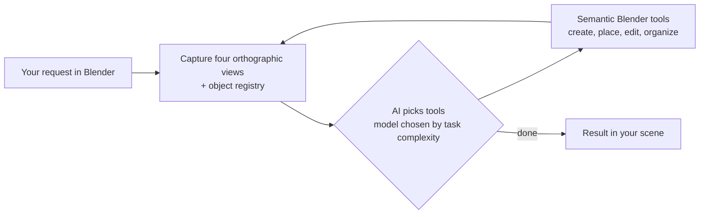

# Sequence 3D

**An AI agent for Blender that builds and edits hard-surface 3D models from plain English, and checks its own work by looking at the scene.**

Designed and directed by [Tayyab Raza](https://www.linkedin.com/in/tayyab3245) · implemented with AI coding agents · Python, TypeScript

<!-- DEMO: drag your .mp4 into this README in GitHub's web editor (keep it under ~10 MB). It will play inline here. -->

**Watch the demo:** [LinkedIn post](LINKEDIN_POST_URL)

---

## What it does

Type "put a handle on the left side of this box" and Sequence 3D does it, then looks at the result and fixes anything that's off. It can create and position objects, organize and rename your scene, and help you understand what went wrong in a model.

## How it works

## Design decisions

- **The AI can see.** After every step it gets four orthographic views of the scene plus an object registry (position, scale, materials, modifiers), so it notices its own mistakes and corrects them.
- **Semantic placement instead of coordinates.** The AI says "snap this to that face" or "align these centres," and a placement engine does the geometry. Guessing raw coordinates was the main source of errors.
- **Pixel-accurate selection.** Object selection switched to screen-space ray casting: the AI picks a point on a rendered view, and a ray into the scene selects whatever it hits. Low-confidence clicks are rejected instead of guessed.
- **Right model for the job.** Simple requests (scale, delete, color) go to a fast model; complex ones go to a stronger one. Estimated cost: about **$0.05–$0.07 per request**.
- **Self-correction.** Generated code is validated and retried automatically when it fails.

## How I tested it

- Gave it modeling tasks and checked: did it follow the prompt, is the orientation right, is the final result correct, did it crash?
- Tracked click accuracy until selection was pixel-accurate.
- Judged it as a user: does it feel easy and helpful, does it save me time, can it organize my scene for me?

## Source

This is a showcase repository. The source code is private while the product is in development. **Source available on request.**
